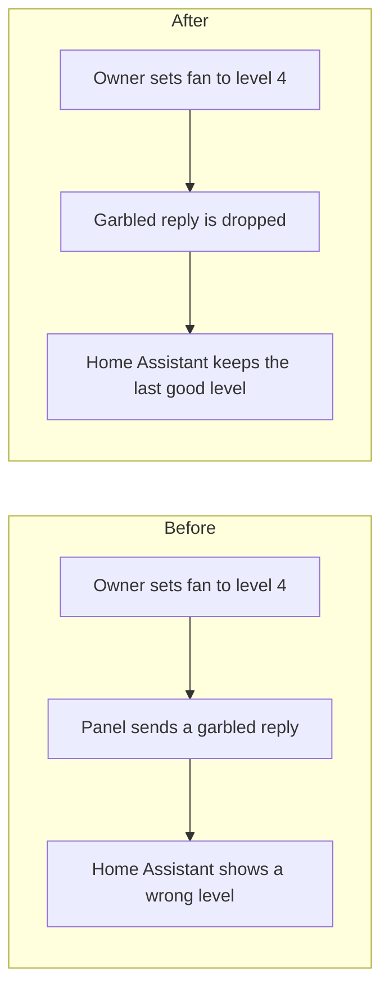
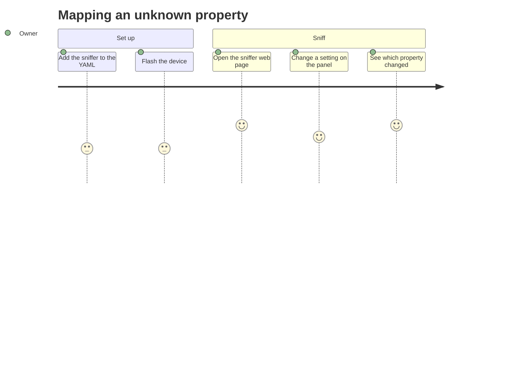
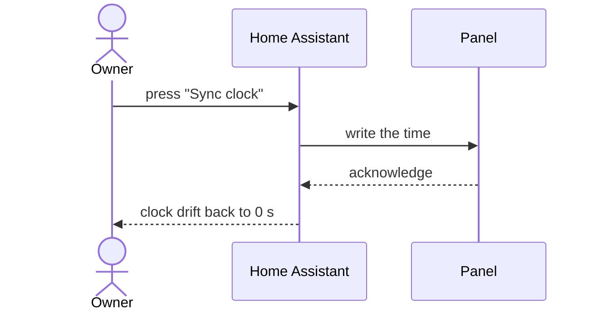
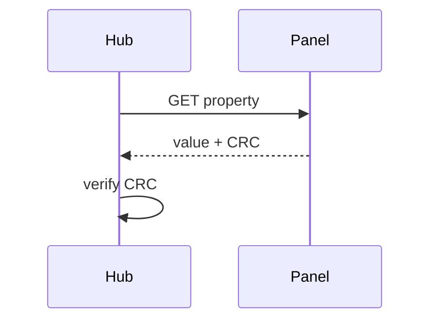

# PR visuals

Smallest view that makes the point; usually one, rarely more than two. Place each next to its caption. Keep only the calls, files, states, and boundaries the reader needs.

## Journeys (What changes for you)

Owner's or developer's steps, before/after; the same shapes fit both. Owner vocabulary: panel, fan, level, Home Assistant, web page. Developer vocabulary: the files, commands and tools they touch (`CLAUDE.md`, a skill, `pre-commit`, a test suite).

Fix → before/after flowchart:



New or changed owner task → `journey`:



Owner, HA, and panel interacting → sequence diagram:



## Technical views (Technical summary)

Logic → pseudocode:

```text
on(message)
  if CRC does not match
    record TIMEOUT for the task
    return
  apply value
```

Runtime control flow → call tree:

```text
SECTouchComponent::loop
  read_uart
    parse_message
      check_crc
  process_task
```

File responsibility / broad refactor → shallow file tree:

```text
components/sec_touch/
├── sec_touch.cpp     # hub: UART, task queue
├── fan/              # fan platform
└── text_sensor/      # labels and raw strings
```

Interaction / data flow → Mermaid:



Changed existing shape → `diff` of that shape.

File layout:

```diff
 tests/config/valid/
   sec_touch_fan_only.yaml
+  sec_touch_all_platforms.yaml   # every platform at once
```

Call tree:

```diff
 parse_message
+  check_crc
   apply_value
```

Control flow:

```diff
 on(message)
+  if CRC does not match
+    record TIMEOUT
+    return
   apply value
```

Mostly new, or omitted context hides ownership/order → full block.

---

Technical views adapted from [Dex Horthy](https://github.com/dexhorthy)'s [`show-me`](https://github.com/humanlayer/skills/blob/main/plugins/show-me/skills/show-me/SKILL.md) skill (HumanLayer).
