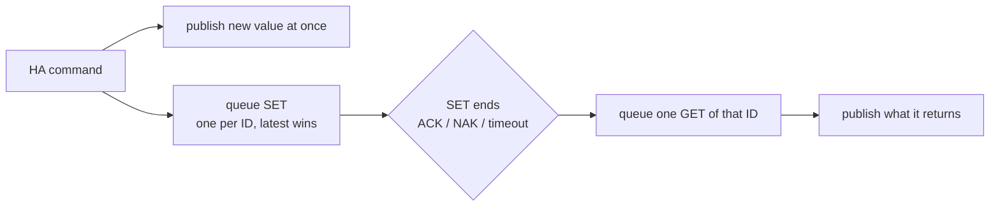

# Time programs in Home Assistant

## Goal

Show and edit each fan pair's **time program** (panel: Zeitprogramm) in Home Assistant: its 5 **switch times**, each with a time, a **level** and an **enabled** flag. Also show which switch time is in effect and what comes next, and set a whole program in one call.

The panel's layout of the program (one block of 11 property IDs per pair) and how sure each part is are in the sec_touch readme, "[Time programs](../components/sec_touch/readme.md#time-programs-zeitprogramm-ids-101166)". This spec doesn't repeat them.

Terms (time program, switch time, enabled, level, switch time in effect) are defined in [`GLOSSARY.md`](../GLOSSARY.md). Each section links the ticket on the map [Wayfinder: time programs in Home Assistant](https://github.com/distante/esphome-components/issues/111) that holds its full reasoning.

**Platform:** any sec_touch target. Sub-devices with `relation:` need ESPHome 2026.11.0, the only version the repo tests.

---

## Known-property catalogue

Decided in [How do the time-program blocks enter the known-property catalogue?](https://github.com/distante/esphome-components/issues/114).

All 66 IDs (101–166) become known properties in one change. From then on they drop out of the sniffer's discover goal and its write probes, and the check goal shows them.

| Array in `protocol_ids.h` | Size | IDs, pair-major |
|---|---|---|
| `TIME_PROGRAM_ENABLED_IDS` | 6 | 101, 112, 123, 134, 145, 156 |
| `TIME_PROGRAM_TIME_IDS` | 30 | 102–106, 113–117, … 157–161 |
| `TIME_PROGRAM_LEVEL_IDS` | 30 | 107–111, 118–122, … 162–166 |

- A `static_assert` checks the stride of 11 between pairs. The arrays are the IDs' one source ([Reuse existing definitions](../.claude/skills/coding-standards/SKILL.md#reuse-existing-definitions)): no `101 + 11·(n−1)` anywhere.
- `GLOBAL_SETTING_IDS` stays `{48, 1, 2}`. `is_known_property()`, `max_known_property_id()` and the page's `knownIds()` add the three arrays.
- `page_bundle.py` parses them with its existing forms; it needs no new form.
- The `time_programs` codegen passes only the pair number (1–6) and switch-time numbers (1–5); C++ looks the IDs up.

**Meaning** (in `known_property_meaning.h` and `known_meaning.mjs`, once each, like the existing rules). This table is the only definition of each field's valid values:

| Field | Matches | Shows | Otherwise |
|---|---|---|---|
| Level | whole decimal 0–`AUTOMATIC_CO2_LEVEL` (9) | the `LEVEL_NAMES` name | `unexpected value x` (10, 11 and 255 included) |
| Enabled | 2 hex digits, either case, ≤ `1F` | `1, 2 enabled` · `none enabled` | `unexpected value x` |
| Time | exactly `HH:MM:SS`, HH 00–23, MM and SS 00–59, after the usual ASCII trim | the trimmed value, like date and clock | `unexpected value x` |

The enabled and time rules are new decode rules: the sniffer spec's [Known-property catalogue](sniffer.md#known-property-catalogue) is amended to list them.

**Check page:** each fan card gets a time-program table: switch times 1–5 × time, level, enabled, each with its meaning and the unexpected flag.

---

## Configuration

Decided in [What do a fan pair's time-program entities look like in YAML and HA?](https://github.com/distante/esphome-components/issues/113), with the entries added by [How do time-program writes from HA work safely?](https://github.com/distante/esphome-components/issues/117) and [Should sec_touch compute which switch time is in effect, and how is it shown?](https://github.com/distante/esphome-components/issues/120).

Time programs are **opt-in per pair**, in a list under the hub:

```yaml
sec_touch:
  time_programs_update_interval: 5min   # optional, default 5min
  time_programs:
    - fan_number: 1               # required, 1–6, once per list
      name: "Kellerraum"          # optional
      switch_times: [1, 2]        # optional, default [1, 2, 3, 4, 5]
      refresh:                    # optional button
        name: "Refresh"
      write_failed:               # optional event entity
        name: "Write failed"
      switch_time_in_effect:      # optional text_sensor
        name: "Switch time in effect"
      running_level:              # optional text_sensor
        name: "Running level"
      next_level:                 # optional text_sensor
        name: "Next level"
      next_change:                # optional timestamp sensor
        name: "Next change"
        time_id: ha_time          # optional with a single time source
```

| Key | Rule |
|---|---|
| `fan_number` | 1–6. A pair listed twice is a config error. Block 6 is handled like any pair. |
| Not listed | No entities, no sub-device, no polling for that pair. |
| `name` | The pair name ([where it shows](#sub-device)). Without it, the pair's `fan:` entry name; without a fan entry, `Fan pair N`. |
| `switch_times` | Only listed switch times get the 3 field entities. A switch time enabled on the panel but not listed stays hidden in HA. 1–5, no duplicates. |
| `next_change` | Needs a `time:` source; none is a config error. |
| `time_programs_update_interval` | Positive time period. |

### Sub-device

Decided in [Can a component give its entities a sub-device without the user declaring it?](https://github.com/distante/esphome-components/issues/125) ([research](https://github.com/distante/esphome-components/blob/research/component-sub-devices/.specs/research/component-sub-devices.md)). ESPHome builds sub-devices only from `esphome: devices:`, so sec_touch can't create one itself.

```yaml
packages:
  sec_touch_devices: github://distante/esphome-components/components/sec_touch/examples/time-program-devices.yaml@stable

sec_touch:
  time_programs:
    - fan_number: 1
      device_id: sec_touch_pair_1_time_program   # optional
```

| Key | Rule |
|---|---|
| `device_id` | Optional. The ID of a device the user declares in `esphome: devices:`. ESPHome 2026.11.0 requires `relation:` on each device (`esphome/esphome/core/config.py`, `DEVICE_SCHEMA`); `relation: child` fits. sec_touch copies it into the config of every entity of that pair **before** the entity schemas are validated, so ESPHome's per-device duplicate-name check, the API and MQTT see it. |
| Without `device_id` | The pair's entities sit on the node's device, and each default name gets the pair name in front: `Kellerraum Switch time 1 time`. |
| Package | `components/sec_touch/examples/time-program-devices.yaml` declares 6 devices, `sec_touch_pair_N_time_program`, named `Fan pair N time program`, `relation: child`. A user who wants other names or fewer devices copies its block into their own `esphome: devices:` instead. |
| `device_id` on an optional entity entry (`refresh`, `write_failed`, live-state entries) | Wins over the pair's `device_id` for that entity. The 15 field entities always follow the pair. |

---

## Entities

Decided in [Which ESPHome entity types and grouping fit a time program?](https://github.com/distante/esphome-components/issues/112) ([research](https://github.com/distante/esphome-components/blob/research/time-program-entities/.specs/research/time-program-entities.md)) and [What do a fan pair's time-program entities look like in YAML and HA?](https://github.com/distante/esphome-components/issues/113).

Per listed switch time *N*, always created:

| Field | Entity | Default name | Value |
|---|---|---|---|
| Time | `datetime`, `type: time` | `Switch time N time` | `HH:MM`; HA keeps seconds, the panel's are always `00` |
| Level | `select`, options = the `LEVEL_NAMES` names the [meaning rule](#known-property-catalogue) accepts | `Switch time N level` | option index = level |
| Enabled | `switch` | `Switch time N enabled` | bit *N−1* of the pair's enabled mask |

- Names are English. With a `device_id` they are the same on every pair, and the sub-device tells them apart; without one they get the pair-name prefix ([Sub-device](#sub-device)). Every name is overridable.
- `entity_category`:

  | Entities | Category |
  |---|---|
  | 15 field entities | `config`, so HA lists them in the device page's Configuration section |
  | `refresh` | `config` |
  | `write_failed` | `diagnostic` |
  | live-state entities | none |

- The switches keep `restore_mode: ALWAYS_OFF` and never call `restore()`: a boot never writes to the panel.
- A value the [meaning rule](#known-property-catalogue) marks unexpected leaves the select or datetime with no state, the switches as they were, logs a warning, and nothing is written.

Optional per pair: `refresh` (button), `write_failed` (event), and the [live-state](#live-state) entities.

---

## Reading

Decided in [Should sec_touch compute which switch time is in effect, and how is it shown?](https://github.com/distante/esphome-components/issues/120).

- **Own poll:** every `time_programs_update_interval` (default 5 min), the hub queues GETs for each listed pair. This is separate from the 5 s fan poll and the 30 s global-settings poll.
- **Which IDs:** the enabled ID and the time and level IDs of the listed switch times. With any live-state entity, the pair's **whole block** (11 IDs), whatever `switch_times` says.
- **Panel clock:** with any live-state entity on any pair, IDs 1 and 2 are polled on the global-settings poll, as for `clock_drift`.
- **First poll:** right after boot, like the global settings.
- **`refresh` button:** one press queues the same GETs as one poll of that pair. The regular poll stays on its schedule.
- Results reach the entities through the hub's existing update listeners.

---

## Writing

Decided in [How do time-program writes from HA work safely?](https://github.com/distante/esphome-components/issues/117). Every kind passed its write probe in [Experiments and write probes for times, Modus and Aktiv 3–5](https://github.com/distante/esphome-components/issues/115).

Writes are allowed at any time, whatever the pair's mode.



| Rule | Detail |
|---|---|
| No SET retry | Nothing is written twice. A failed SET is reported, then the read-back GET publishes the truth. |
| One queued SET per ID | A newer write to an ID with a SET still queued replaces that task's value in place. A SET already in flight isn't touched; the newer write queues behind it. |
| Time | Written as `HH:MM:00`. Seconds from HA are dropped, never rounded. |
| Level | The select's index, 0–9, as a decimal string. |
| Enabled mask | Per pair, the hub keeps the requested bit changes (bits to set, bits to clear). When the write is due: GET the mask fresh, apply only those bits, SET. Bits of switch times outside `switch_times` and any bit above switch time 5's (value `20` and up) stay as they are. Changes merge; per bit, the later request wins. |
| Mask GET fails | The hub retries a GET only after a dropped reply (`get_retry.h`), not after a timeout or NAK. When the GET fails: write nothing, fire `mask_unreadable`, log a warning, republish the switches from the last good mask. |
| Read-back | A `not_kept` is a read-back that differs from what was sent; seconds are ignored when comparing times. Live-state entities recompute from the read-back. |

**`write_failed` event types** (an ESPHome event carries only its type; the log names the field, and in HA the entity that jumped back shows it):

| Type | When |
|---|---|
| `refused` | The SET got a NAK |
| `timeout` | The SET got no answer |
| `not_kept` | The read-back differs from what was sent |
| `mask_unreadable` | The fresh mask GET failed; nothing was written |

HA's toast can't show these: entity commands from HA get no result back from ESPHome.

---

## Live state

Decided in [Should sec_touch compute which switch time is in effect, and how is it shown?](https://github.com/distante/esphome-components/issues/120). The panel has no property that says which switch time is in effect ([Find the ID that says which switch time is in effect](https://github.com/distante/esphome-components/issues/116)), so sec_touch computes it.

**Model** (a pure header, [Implementation notes](#implementation-notes)):

- **In effect:** as defined in the [glossary](../GLOSSARY.md#language) (Switch time in effect). "At or before" includes the panel time itself.
- **Next change:** the first enabled switch time strictly after the panel time, wrapping to the next day.
- **Assumption:** the panel never shows the level it runs, so this model can't be checked on the device. The readme says so.
- **Clock:** the panel clock (IDs 1 and 2), which is what fires the switch times. Advanced with `millis()` between reads, re-anchored on each good read. Drift needs no handling.
- **Running:** the program runs only when the pair's level ID reads `AUTOMATIC_TIME_LEVEL` (10).

**Entities** (each optional, under the pair's `time_programs` entry):

| Entity | Type | States |
|---|---|---|
| Switch time in effect | text_sensor | `switch time N` (N 1–5), or a state word from the cases table |
| Running level | text_sensor | a level name ([meaning rule](#known-property-catalogue)), or a state word from the cases table |
| Next level | text_sensor | a level name ([meaning rule](#known-property-catalogue)), or a state word from the cases table |
| Next change | timestamp sensor | time source now + (next switch time − panel now); no value (NaN) when there is none |

The state words live in the live-state model's header ([Implementation notes](#implementation-notes)), the one definition code and tests use ([Reuse existing definitions](../.claude/skills/coding-standards/SKILL.md#reuse-existing-definitions)). `not running` is used, not `off`, because `off` is level 0's name.

| Case | Switch time in effect | Running level | Next change / Next level |
|---|---|---|---|
| Not in Automatik Zeit (level ID ≠ 10) | `not running` | `not running` | no value (NaN) / `not running` |
| Automatik Zeit, no switch time enabled | `none` | `none` | no value (NaN) / `none` |
| Two enabled switch times tied at the time in effect | `conflict` | `conflict` | as normal |
| The next change is a tie | as normal | as normal | valid / `conflict` |
| A tie at another time of day | no effect | no effect | no effect |
| Exactly one enabled switch time | that switch time | its level | itself 24 h later / its level |
| Inputs not read once yet (boot) | nothing published | nothing published | nothing published |
| An input read fails or is unexpected | from the last good value of that input (for the clock: the old anchor), warning logged | same | same |
| … and that input never read well yet | as boot | as boot | as boot |

- **Inputs:** the pair's enabled mask, its 5 times and 5 levels, its level ID, and the panel clock.
- **Recompute:** on every input read, plus one timeout set for the next change. An entity publishes only when its value changes.
- The HA fan entity isn't changed: in Automatik Zeit it still shows on, preset Automatic Time. Whether it should follow the running level is [sec_touch: in Automatik Zeit the fan shows on even when the program runs level 0](https://github.com/distante/esphome-components/issues/124).

---

## Bulk-set action

Decided in [What does the bulk-set action for a pair's time program look like?](https://github.com/distante/esphome-components/issues/119).

`sec_touch.set_time_program` is an ESPHome automation action with `on_success:` and `on_error:`. It sets a pair's whole program. To call it from HA, the user wraps it in their own `api: actions:` with `api.respond`; the readme will have the block to copy ([Docs and release](#docs-and-release)). It also works on the device (template button, `on_time`).

| Argument | Type | Rule |
|---|---|---|
| `fan_number` | templatable int | Listed in `time_programs:`. A constant is checked at config time; a lambda at run time (`invalid_argument`). |
| `times` | templatable list of 5 strings | `HH:MM`, or `HH:MM:SS` with the seconds dropped |
| `levels` | templatable list of 5 ints | 0–9 |
| `enabled` | templatable list of 5 bools | |

Position *i* is switch time *i*. HA's `string[]`, `int[]` and `bool[]` pass straight through.

| Rule | Detail |
|---|---|
| Scope | Always all 5 switch times. The `switch_times` filter is ignored; it only hides entities. |
| Validation | Every argument is checked before any write. One bad value → `invalid_argument`, nothing written. |
| Order | The 5 times and 5 levels, then one mask SET built from a fresh mask GET. Only the 5 switch-time bits are replaced. |
| Writes | 11 writes: all 5 times, 5 levels and the mask, even when the cache shows the same value (it can be 5 min old). Same per-field path as [Writing](#writing). |
| Failure | Writing continues after a failed field. `on_success` fires only when every read-back matches; otherwise `on_error` gets `error`, and the pair's `write_failed` fires per failed field. |
| Overlap | A second call for the same pair while one runs → `busy`, nothing written. An entity write that replaces a bulk value shows up as `not_kept` in the bulk report. |
| Deadline | None. HA waits 30 s for a response by default (aioesphomeapi); past it the writes still finish and the entities show the truth. The readme notes it. |

| Case | `error` |
|---|---|
| Bad argument | `invalid_argument: switch time 4 level 12 not in 0–9` |
| Write failures | `2 of 11 writes failed: switch time 3 level refused; enabled mask mask_unreadable` |
| Overlap | `busy` |

The [readme copy block and HA call](https://github.com/distante/esphome-components/issues/119#issuecomment-7168530664) are in the deciding ticket; the readme takes them over.

---

## Memory

| Where | Storage | Why |
|---|---|---|
| GET and SET tasks | the hub's existing heap queue (`std::deque<std::unique_ptr<BaseTask>>`) | It's the hub's task design. A static queue would be a hub refactor outside this spec. |
| Latest wins per ID | none new | It overwrites the queued `SetDataTask`'s fixed `value` buffer in place. |
| Requested mask bits | static, 6 pairs × (set, clear) `uint8_t` | |
| Panel clock anchor | static | |
| Bulk `error` text | `std::string`, built only when a bulk call fails | ESPHome's `api.respond` takes a `std::string` anyway. This is the one stated heap use ([Memory rule](../.claude/skills/coding-standards/SKILL.md#memory)). |
| Entities | static: ESPHome codegen builds each with placement new into a `static` buffer (`esphome/esphome/cpp_generator.py`, `Pvariable`) | Worst case 6 pairs × (15 + 4 + 2) = 126. Estimated 30–60 B each ([research](https://github.com/distante/esphome-components/blob/research/time-program-entities/.specs/research/time-program-entities.md#cost-of-90-extra-entities)), measured in the device check. No cap until then. |

---

## Implementation notes

Pure headers ([Tests](../.claude/skills/coding-standards/SKILL.md#tests)) hold the logic; the entities and the hub only call them:

| Seam | Holds |
|---|---|
| Time-program IDs | pair + switch time → ID lookups over the three arrays |
| Field codec | parse and format `HH:MM:SS`, level 0–9, the enabled mask |
| Mask merge | pending set / clear bits, applying them to a fresh mask |
| Live-state model | inputs → switch time in effect, running level, next change, next level, state words |
| Bulk validation | the argument checks and the `error` text |

The hub's queue paths (latest wins, read-back GET, mask GET-then-SET, `busy`) get host component tests.

---

## Docs and release

Ships in **v1.5.0** with the sniffer goals and experiments. The work for this section is in [Docs, v1.5.0 changelog and device checks](https://github.com/distante/esphome-components/issues/80).

**Changelog (v1.5.0), time programs:**
- **Time programs in HA**, opt-in per pair under `sec_touch: time_programs:`: time, level and enabled per switch time, read and write.
- **Live state:** switch time in effect, running level, next level and next change, computed from the program and the panel clock.
- **`sec_touch.set_time_program`** sets a pair's whole program; the readme shows how to call it from HA.
- **Sniffer:** IDs 101–166 are known properties: discover skips them, check shows them on each fan card.

**Readme:**
- The `time_programs:` YAML and every key.
- That live state is computed, and its model is an assumption.
- That the fan entity still shows on in Automatik Zeit.
- The bulk-action copy block, the HA call, and HA's 30 s response timeout.
- The measured RAM cost.
- IDs 1 and 2 are also polled with any live-state entity (readme "Panel Clock" and the `GLOBAL_SETTING_IDS` note say only with `clock_drift`).
- The known-property list under "Sniffer page" and the "Known Ids" section gain the three time-program arrays.
- "Not in `protocol_ids.h` yet: #85 decides" under Time programs: point at this spec's [catalogue](#known-property-catalogue).

**Device check** (maintainer's controller): one heap check with 6 pairs × all switch times + every live-state entity + the sniffer, plus one write per field kind and one bulk call, each checked on the panel.

---

## Out of scope

- Naming and saving profiles ("summer" / "winter"): HA or a future custom-cards repo keeps them ([What do a fan pair's time-program entities look like in YAML and HA?](https://github.com/distante/esphome-components/issues/113)).
- The fan entity following the running level: [sec_touch: in Automatik Zeit the fan shows on even when the program runs level 0](https://github.com/distante/esphome-components/issues/124).
- Known-property names and suspected meanings in the sniffer: [Sniffer: known properties carry a name and purpose](https://github.com/distante/esphome-components/issues/85) and [Sniffer: suspected meanings for unknown IDs, shown as hints](https://github.com/distante/esphome-components/issues/86).
- An HA schedule helper as the interface.
- JSON attributes over the native API.

---

## Acceptance criteria

1. IDs 101–166 are defined as in [Known-property catalogue](#known-property-catalogue).
2. Check queries and shows IDs 101–166; discover and write probes skip them. Each fan card shows the time-program table with meanings; level 10, mask `20` and time `24:00:00` show as `unexpected value x`.
3. A pair not in `time_programs:` gets no entities and no polling. A listed pair gets 3 entities per listed switch time, named by the rules in [Configuration](#configuration), [Sub-device](#sub-device) and [Entities](#entities). A config the [Configuration](#configuration) table calls an error fails validation: a duplicate `fan_number`, a switch time outside 1–5 or listed twice, `next_change` without a time source, a `time_programs_update_interval` that isn't a positive time period. A config with the example package validates and compiles.
4. A pair's `device_id` lands on every entity of that pair before entity validation, so a name repeated on two pairs' devices is valid and repeated on one device is an error. A `device_id` on an optional entity entry wins for that entity; the 15 field entities always follow the pair. Every entity has the `entity_category` of [Entities](#entities).
5. Time-program IDs are polled as in [Reading](#reading), and never on the fan or global-settings poll. A `refresh` press queues one poll of its pair and leaves the schedule as it was.
6. An HA write follows [Writing](#writing): published at once, one queued SET per ID (a newer value replaces the queued one), after the SET ends one GET whose value is published. No SET is retried.
7. A switch write GETs the mask, changes only the requested bits and SETs it. A failed GET writes nothing. `write_failed` fires each type of the [event table](#writing) in its case.
8. Time writes send `HH:MM:00`. A level the [meaning rule](#known-property-catalogue) marks unexpected, read from the panel, leaves the select with no state, and nothing is written.
9. Live state follows the [model](#live-state) and every row of its cases table, and publishes only on change. Tests cover: exactly one enabled switch time, a failed or unexpected input before and after a good read, a switch time exactly at the panel time (in effect) and the next change strictly after it. `not running` appears whenever the level ID isn't 10.
10. `sec_touch.set_time_program` follows [Bulk-set action](#bulk-set-action): validates everything first, writes times, levels, then the mask, reports `invalid_argument`, `busy` or the failed-field list in `error`, and fires `on_success` only when every read-back matches.
11. No heap use beyond the [Memory](#memory) table.
12. The device check is recorded with the heap numbers, and the readme states them.
