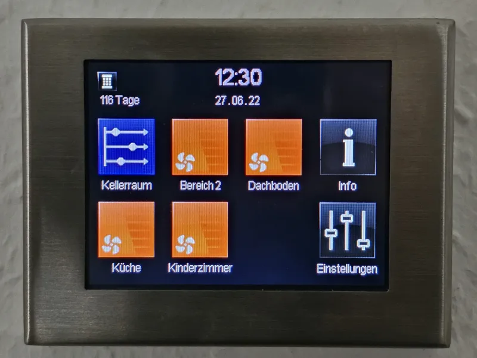
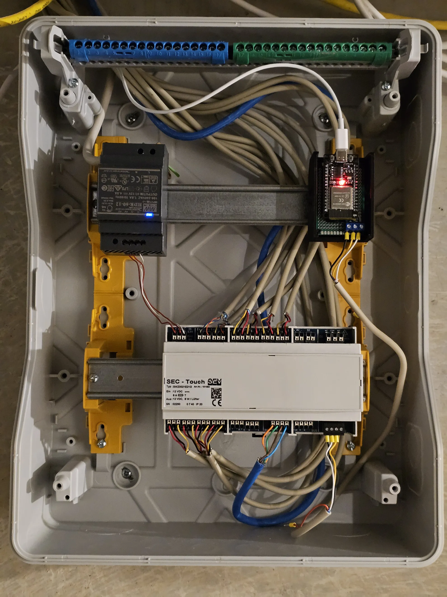
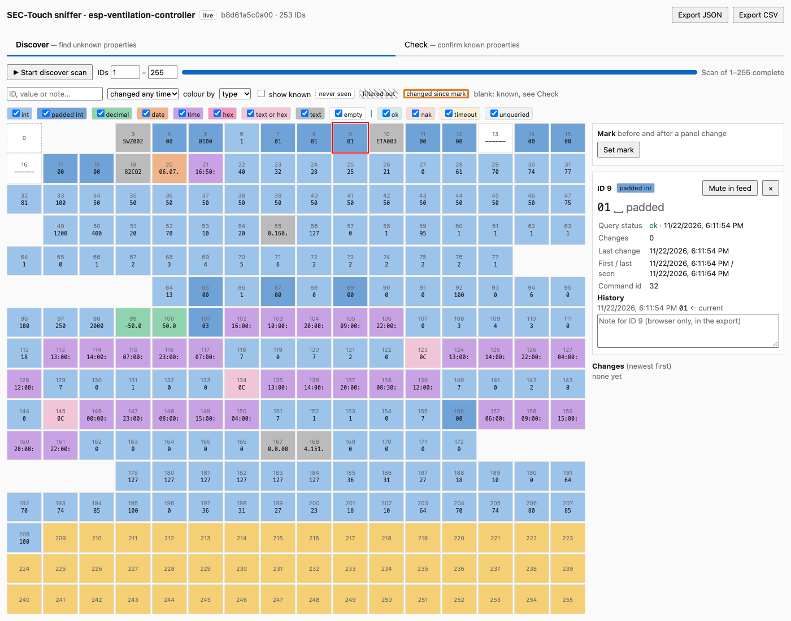
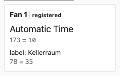
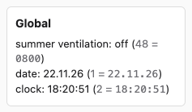
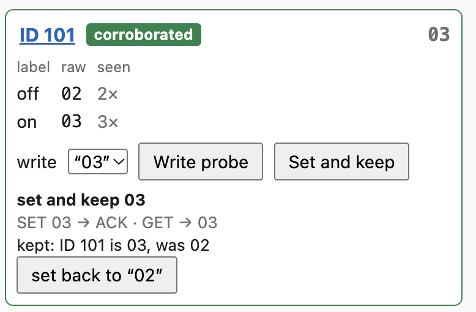
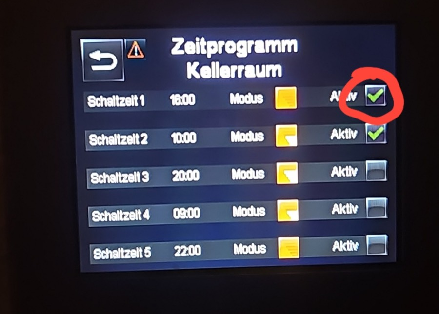
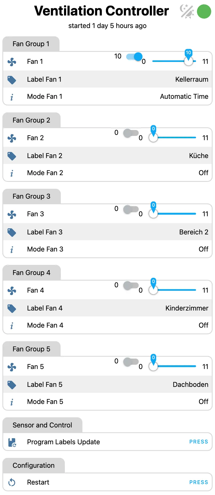

# SEC-TOUCH ESPHome Component
This is a component that allows you to control your SEC-TOUCH ventilation controller (Dezentrale Lüftung Zentralregler SEC-Touch) from your ESP device and integrate it to Home Assistant.

<div class="text-center">
  
</div>

It allows you to change the level of the fan pairs, put them into their special modes (automatic, time, etc), and toggle global settings such as **Summer Ventilation**. There is no way to change the timing intervals for now. You need to make that in the SEC-TOUCH device itself.

The SEC-Touch device is always the source of true. No fan state restoration is done after a power loss.

## First of all thanks to:

- [Manuel Siekmann](https://github.com/Manuel-Siekmann/) who did the heavy lifting of find out the communication protocol of the SEC-TOUCH device in his [VentilationSystem](https://github.com/Manuel-Siekmann/VentilationSystem) project.
- [Samuel Sieb](https://github.com/ssieb) who helped me to understand some basic c++ and ESPHome concepts and responded my questions on Discord.

# Do it at your own Risk!

The SEC-Touch has no open API or documentation for their UART interfaces, so I can no and DO NOT offer any warranty, everything here is reverse engineered. I have no affiliation with the company that produces the SEC-TOUCH device nor do I want this component to be used for financial gains. The only reason I developed this is because the official alternative is needs internet to works, which I do not want for a device that costs +200€ EURO.

If you decide to use this component a **fan damage can not be ruled out**. **You** are the only responsible in case something goes wrong.

Yes Really.

# Hardware.

## Required
- An ESP32 or ESP8266 device.
  - I use [this one with USB C](https://amzn.to/4stOUoz).
- [4 Pin Pluggable Terminals](https://amzn.to/4jqp9kP)
- [4 core](https://amzn.to/3EK0uao) or [3 core cable](https://amzn.to/49e3jMB) (depending on how you can/want to power the ESP device)

## Optional
- [Breakout board](https://amzn.to/4aGkvwM) if you do not want to solder stuff
- [PCB board with header connectors](https://amzn.to/3YUpXos) if you want to solder everything (like I did, see bellow).
- [Din Rail Mounting clips](https://amzn.to/4aBUr5V) to mount the device if needed.

# Connection

The SEC-TOUCH has an "PC" port at the right bottom part. It has an `3.x` volts output. It worked to power my ESP32 device when I was using Software UART, but when I switched to Hardware UART it didn't work anymore. When I measured the voltage it was around `3.2v` tops.

I recommend you to power your ESP32 device using another source.

That said, probably it has enough power for an ESP8266 device that uses software UART.

### ESP32 cable connection (using external power )
The same but without the 3.3v connection. 😬

|ESP32  | SEC-Touch|
|--- | ---|
|GND | GND (1st from the left)|
|GPIO 17 | RX (2nd from the left)|
|GPIO 16 | TX (3rd from the left)|

Pin numbers count from the **left, looking straight at the "PC" port**. RX and TX are named from the SEC-Touch's side, so they cross over: the ESP's TX goes to the SEC-Touch's RX, and the other way round.

```
            SEC-Touch "PC" port (front view)
      ┌──────────┬──────────┬──────────┬──────────┐
      │    1     │    2     │    3     │    4     │
      │   GND    │    RX    │    TX    │  3.3 V   │
      └────┬─────┴────┬─────┴────┬─────┴────┬─────┘
           │          │          │          │
           │          │          │          ╳  not connected
           │          │          │             (external power)
          GND      GPIO17     GPIO16
                  (ESP TX)   (ESP RX)
                    ESP32
```

> [!TIP]
> If you get no answer at all, check the counting direction first. Counted from the right, pin 2 is the SEC-Touch's **TX**, which swaps RX and TX. The port talks at **28800 baud** (8N1), so a sniffer set to any other speed shows garbage.

### ESP8266 connection
<div class="text-center">
  
</div>

## Final Installation Example
<div class="text-center">
  
</div>


# Configuration:

Add this to `your-device.yaml` file:
```yaml

external_components:
  - source:
      type: git
      url: https://github.com/distante/esphome-components
      ref: stable

wifi:
  ssid: !secret wifi_ssid
  password: !secret wifi_password

  # Enable fallback hotspot (captive portal) in case wifi connection fails
  ap:
    ssid: "Ventilation-Controller"
    password: "supersecretpassword"

captive_portal:


web_server:
  port: 80
  local: true
  log: false
  version: 3
  sorting_groups:
    - id: group_1
      name: Fan Group 1
      sorting_weight: -100
    - id: group_2
      name: Fan Group 2
      sorting_weight: -99
    - id: group_3
      name: Fan Group 3
      sorting_weight: -98
    - id: group_4
      name: Fan Group 4
      sorting_weight: -97
    - id: group_5
      name: Fan Group 5
      sorting_weight: -96
    - id: group_6
      name: Fan Group 6
      sorting_weight: -95
    - id: group_settings
      name: Configuration
      sorting_weight: -94

uart:
  id: sec_touch_uart
  tx_pin:
    number: GPIO17
  rx_pin:
    number: GPIO16
  baud_rate: 28800

sec_touch:
  uart_id: sec_touch_uart
  update_interval: 5s # 5s is the default
  global_settings_update_interval: 30s # 30s is the default — controls how often global settings (e.g. summer ventilation) are re-polled
  optional_crc: false # false is the default — set to true if your device sends responses without a CRC field

fan:
  - platform: sec_touch
    icon: "mdi:fan"
    fan_number: 1
    name: "Fan 1"
    web_server:
      sorting_group_id: group_1
  - platform: sec_touch
    icon: "mdi:fan"
    fan_number: 2
    name: "Fan 2"
    web_server:
      sorting_group_id: group_2
  - platform: sec_touch
    icon: "mdi:fan"
    fan_number: 3
    name: "Fan 3"
    web_server:
      sorting_group_id: group_3
  - platform: sec_touch
    icon: "mdi:fan"
    fan_number: 4
    name: "Fan 4"
    web_server:
      sorting_group_id: group_4
  - platform: sec_touch
    icon: "mdi:fan"
    fan_number: 5
    name: "Fan 5"
    web_server:
      sorting_group_id: group_5
  - platform: sec_touch
    icon: "mdi:fan"
    fan_number: 6
    name: "Fan 6"
    web_server:
      sorting_group_id: group_6


switch:
  - platform: sec_touch
    name: "Summer Ventilation"
    icon: "mdi:weather-sunny"
    web_server:
      sorting_group_id: group_settings

time: # only needed for sync_clock / clock_drift, see "Panel Clock" below
  - platform: homeassistant

button:
  - platform: sec_touch
    program_text_update:
      name: "Program Labels Update"
      icon: "mdi:book-refresh"
    sync_clock:
      name: "Sync Panel Clock"
  - platform: restart
    name: "Restart"

text_sensor:
  - platform: sec_touch
    fan_number: 1
    label_text:
      name: "Label Fan 1"
      web_server:
        sorting_group_id: group_1
    mode_text:
      name: "Mode Fan 1"
      web_server:
        sorting_group_id: group_1
  - platform: sec_touch
    fan_number: 2
    label_text:
      name: "Label Fan 2"
      web_server:
        sorting_group_id: group_2
    mode_text:
      name: "Mode Fan 2"
      web_server:
        sorting_group_id: group_2
  - platform: sec_touch
    fan_number: 3
    label_text:
      name: "Label Fan 3"
      web_server:
        sorting_group_id: group_3
    mode_text:
      name: "Mode Fan 3"
      web_server:
        sorting_group_id: group_3
  - platform: sec_touch
    fan_number: 4
    label_text:
      name: "Label Fan 4"
      web_server:
        sorting_group_id: group_4
    mode_text:
      name: "Mode Fan 4"
      web_server:
        sorting_group_id: group_4
  - platform: sec_touch
    fan_number: 5
    label_text:
      name: "Label Fan 5"
      web_server:
        sorting_group_id: group_5
    mode_text:
      name: "Mode Fan 5"
      web_server:
        sorting_group_id: group_5
  - platform: sec_touch
    fan_number: 6
    label_text:
      name: "Label Fan 6"
      web_server:
        sorting_group_id: group_6
    mode_text:
      name: "Mode Fan 6"
      web_server:
        sorting_group_id: group_6

```

Notice that the fans numbers are ordered so:

|   --   |   --   |   --   |   --   |
|--------|--------|--------|----|
| Pair 1 | Pair 3 | Pair 5 | ℹ️ |
| Pair 2 | Pair 4 | Pair 6 | ⚙️  |


## Panel Clock

The SEC-Touch keeps its own date and clock (shown on the touch screen and used by the "Automatik Zeit" programs). It
drifts, and it has no daylight saving setting, so it needs setting at every switch. With a [time source](https://esphome.io/components/time/)
in your config, the component can show the drift and set the panel clock:

```yaml
time:
  - platform: homeassistant
    id: ha_time

button:
  - platform: sec_touch
    sync_clock:
      name: "Sync Panel Clock"
      # time_id: ha_time  # only needed with more than one time source

sensor:
  - platform: sec_touch
    clock_drift:
      name: "Panel Clock Drift"
      # time_id: ha_time
```

`platform: homeassistant` only has a time while Home Assistant is reachable. Without Home Assistant (e.g. the
[web server fallback](examples/webserver-fallback.yaml)), use `platform: sntp` instead.

- **`clock_drift`**: seconds the panel clock is ahead of the time source (negative: behind).
  The panel date and clock are read on every global settings poll (`global_settings_update_interval`); what polls
  each: [Global Settings](#global-settings).
  In the repeated hour when daylight saving time ends, the panel's local time is read as
  standard time, so even a correct panel shows +3600 s for that hour.
- **`sync_clock`**: sets the panel date and clock from the time source. The panel drops the
  seconds on write, so the write waits for the next full minute (up to 60 s after the press). There is no automatic sync: trigger the button from a Home Assistant
  automation, e.g. when the drift sensor exceeds a threshold or after a daylight saving change.

## Time program live state

Optional entities under a pair's `time_programs:` entry ([spec](../../.specs/time-programs.md#live-state)). The
`time_programs:` keys themselves (`web_server` among them), the field entities, `refresh` and `write_failed` are in
the spec's [Configuration](../../.specs/time-programs.md#configuration), and `sec_touch.set_time_program` in its
[Bulk-set action](../../.specs/time-programs.md#bulk-set-action), until this readme takes them over
([#80](https://github.com/distante/esphome-components/issues/80)):

```yaml
sec_touch:
  time_programs:
    - fan_number: 1
      switch_time_in_effect:   # text_sensor: "switch time N" or a state word
        name: "Switch time in effect"
      running_level:           # text_sensor: a level name or a state word
        name: "Running level"
      next_level:              # text_sensor: a level name or a state word
        name: "Next level"
      next_change:             # timestamp sensor, needs a time: source
        name: "Next change"
```

| State word | When |
|---|---|
| `not running` | The pair's level isn't Automatic Time (10) |
| `none` | Automatic Time, but no switch time enabled |
| `conflict` | Two enabled switch times share that time |

- **Computed, not read.** The panel never says which switch time it runs. sec_touch computes it from the program, the pair's level and the panel clock (ID 2, polled as [Global Settings](#global-settings) lists). The model is an assumption the panel can't confirm.
- **Needs the pair's `fan:` entry**, which polls the pair's level. Without it the config fails.
- **Polling:** with any live-state entity, the pair's whole block of 11 IDs is polled, whatever `switch_times` lists.
- **`next_change` shows Unknown** whenever the other three show `not running` or `none`: a timestamp can't hold a state word, so it has no value then.
- **`next_change` precision:** rounded to the minute, but HA gets it as a float, so it can be off by up to ±64 s.
- The fan entity isn't changed: in Automatik Zeit it still shows on, preset Automatic Time.

## Logging

Each component uses a distinct log tag. You can suppress noisy tags without hiding everything by adding a `logger` block to your YAML:

```yaml
logger:
  logs:
    sec_touch: WARN           # core component (polling loop, task queue, watchdog)
    sec_touch.uart: WARN      # raw UART sends/receives — very noisy at DEBUG
    sec_touch.incoming: WARN  # incoming message buffer (overflow warnings)
    sec_touch.fan: WARN       # fan entity state changes and control calls
    sec_touch.mode_select: WARN  # mode select entity
    sec_touch.switch: WARN  # summer ventilation switch
    sec_touch.clock: WARN   # panel clock sync and drift
    sec_touch_sniffer: DEBUG  # sniffer discoveries and scan progress
```

| Tag | Component | Noisy at DEBUG? |
|---|---|---|
| `sec_touch` | Core component — loop, task queue, watchdog | Yes |
| `sec_touch.uart` | Raw UART sends/receives | Very |
| `sec_touch.incoming` | Incoming message buffer | Low |
| `sec_touch.fan` | Fan entity | Moderate |
| `sec_touch.mode_select` | Mode select entity | Low |
| `sec_touch.switch` | Summer ventilation and other global switches | Low |
| `sec_touch.clock` | Panel clock sync and drift | Low |
| `sec_touch_sniffer` | Sniffer (passive + active scan) | Moderate |

> **Tip:** When using the sniffer and you only want to see discovery output, set `sec_touch` and `sec_touch.uart` to `WARN` and `sec_touch_sniffer` to `INFO` or `DEBUG`.

## Sniffer

The sniffer records every data message the SEC-Touch sends, registered property IDs included, keeping each value byte-exact as the panel sent it. This lets you discover unknown property IDs for future use.

Two modes are available:

- **Passive** (always on): unknown IDs that arrive during normal polling are captured automatically.
- **Active scan** (optional): queries property IDs one at a time, in one of two goals. **Discover** goes through a range (1–255 unless the start names one) and skips the known properties; **check** queries exactly the known properties, registered ones included. Normal polling is paused while scanning. A start or stop waits for the request in flight: the first query (after a start) or polling (after a stop) goes out once its reply arrives or times out. Every start begins at the goal's first ID; a stopped scan does not resume.

Results are shown on the [sniffer page](#sniffer-page), every captured ID included, registered ones too. Scans are started and stopped there.

> **Note:** The sniffer runs on ESP32 only. It reserves its memory once at boot: about 27 KB of heap, as measured on a real controller. Nothing is allocated per discovered ID, so a scan does not grow it. To compare heap sensors before and after enabling the sniffer, take both readings a few minutes after boot: the minimum free heap drops by 13–16 KB within the first minute whether the sniffer runs or not.

### Example

```yaml
web_server_base:   # or web_server:

sec_touch_sniffer:
```

`id` and `sec_touch_id` are optional: the sniffer uses the only `sec_touch` hub. It has no other options.

When a scan has queried all its IDs, polling resumes automatically. If a property ID does not respond within 2 seconds the scan retries it once. If it times out again the ID is skipped and a warning is logged.

### Sniffer page

The sniffer serves, at `http://<device>/sniffer`, a page for working out what the IDs mean: a map of IDs 0–255 coloured by guessed type or by scan status, a drawer per ID with its raw value and up to 7 previous values, a feed of recent changes, filters, per-ID notes, scan start and stop, a JSON and CSV export, and a "Clear data" button that empties the captured records on the device and in the browser (notes and mutes stay). Notes and a copy of the records are kept in the browser, keyed by the ESP's MAC, and never sent to the device.

<p align="center">
  
</p>

For a known property, the Check tab shows what its value means. Known properties are the fan levels (173–178), fan labels (78–83), summer ventilation (48), date (1), clock (2) and the [time programs](#time-programs-zeitprogramm-ids-101166) (101–166). Each fan card also gets its pair's time program: the enabled mask once, and a row per switch time.

| Property | Shows | `unexpected value x` (in red) when |
|---|---|---|
| Fan level, fan label | its name ("level 3", "Burst", "Bad") | the value has no name |
| Summer ventilation | `0A00` as "on", `0800` as "off" | any other value |
| Date, clock | the value as sent | never |
| Enabled mask | "1, 2 enabled" or "none enabled" | not 2 hex digits, or above `1F` |
| Switch time: time | the value as sent | not `HH:MM:SS` within the day |
| Switch time: level | its level name | not a level 0–9 |
| Switch time: enabled | yes or no, from its bit of the mask | the mask is unexpected |

The names come from [`fan_level.h`](fan_level.h) (levels) and [`protocol_ids.h`](protocol_ids.h) (labels and summer ventilation), the same tables the component uses.

| Fan level (173) and label (78) | Summer ventilation (48), date (1) and clock (2) |
|---|---|
|  |  |

- **HTTP server:** the page needs `web_server_base:`, or `web_server:`, which loads it. Without either the config fails. The port is the server's; the sniffer has no port or auth options of its own.
- **Sockets:** the page raises the HTTP server's client limit by 2, one for the page's polling and one spare for a reload.
- **Open on the LAN without auth:** without `web_server: auth:`, anyone on your network can open the page, start or stop a scan, which pauses normal polling, clear the captured records, and **write values to the panel's unknown properties** with a write probe. Set `web_server: auth:` while the sniffer is enabled. When set, `web_server: auth:` and `allowed_origins` also apply to `/sniffer`, `/sniffer/data`, `/sniffer/scan/*`, `/sniffer/clear`, `/sniffer/probe` and `/sniffer/restore`.
- **Time-program writes during a scan:** starting a scan drops the queued time-program writes, and starting or
  stopping one drops the write in flight (each ends as `timeout`; a running `sec_touch.set_time_program` ends with
  `on_error`). Writes stay allowed while it scans: one made then, such as a `sec_touch.set_time_program` retried from
  `on_error`, goes out between the scan's queries. Its read-back answer goes to the scan, so nothing is confirmed:
  such a call ends with `on_error` (times and levels `not_kept`, the mask `mask_unreadable`).
- **Captive portal:** while the device runs its captive-portal access point (the Wi-Fi fallback), the portal answers every GET request, so the page may be unreachable until the device is back on your network.
- **Scripting a scan:** `curl -X POST -H 'Content-Length: 0' 'http://<device>/sniffer/scan/start?goal=discover&from=1&to=208'` (or `?goal=check`, or `/stop`). Without the explicit empty body the server answers `411`. A missing or unknown `goal` means discover; without `from` and `to` discover covers 1–255. Discover with only one of them, a non-numeric one, one above 255 or `from` above `to` gets a `400` and starts nothing; check ignores them. Instead of a range, discover takes `ids=12,40,77` (at most 100 distinct IDs) and queries only those, in ascending order. One run at a time: a scan, write probe or restore start while another runs gets `409` and starts nothing; a stop works during a scan only.
- **Scripting a write probe:** `curl -X POST -H 'Content-Type: text/plain' --data-binary '03' 'http://<device>/sniffer/probe?id=77'` writes `03` to unknown property 77, reads it back, and restores the original; `/sniffer/restore?id=77` writes its body and checks it without restoring anything, which is how the page puts an original back and how its "Set and keep" works. The value is the exact body, at most 15 bytes; send it as `text/plain` (a form body never reaches the sniffer). The data endpoint, its `probe` result and its JSON are described in the [spec](../../.specs/sniffer.md#devicepage-contract).

See [RAW_VALUES.md](RAW_VALUES.md#how-to-reproduce) for a capture walkthrough.

#### Finding what an ID controls

An experiment finds the unknown ID behind one panel setting: you change the setting on the panel, capture, and the page keeps only the IDs that follow it. The example is the one that found ID 101 through the "Aktiv" checkbox of "Schaltzeit 1" on the panel's "Zeitprogramm Kellerraum" screen. (ID 101 turned out to hold the Aktiv boxes of all 5 switch times, see [Time programs](#time-programs-zeitprogramm-ids-101166).)

1. **Open the page** at `http://<device>/sniffer`, on the Discover tab. In the scan row, set **from** and **to** to the range to search. The whole range 1–255 always works. A smaller one, such as 90–130, makes every capture quicker, but the setting's ID must be inside it. The experiment keeps the range of its first capture.
2. **Start an experiment.** The coach box on the right asks "What setting will you change on the panel?". Type the setting, such as `Schaltzeit 1 aktiv`, and click **Start experiment**. A sub-tab with that name appears.
3. **Capture a first value.** Set the setting on the panel, type a name for its value in "value label", such as `off`, and click **Capture**. The scan row shows the progress; when it ends, the capture is listed under **Captures**.
4. **Capture a second value.** The coach says "Change … to a different value". Change it on the panel, name it (`on`) and capture.
5. **Go back.** The coach says "Go back to “off” and capture". Set the panel back, pick the same label from the suggestions and capture. The IDs that went `off` → `on` → `off` with the panel now show as cards with an orange **candidate** badge, and orange rings in the grid. From here on a capture only queries the candidates ("next capture: 1 candidate").
6. **Corroborate.** The coach asks for one more capture of a value. Once two values have two captures each, a candidate that kept its values turns green: **corroborated**, and the coach says "ID 101 corroborated". An ID that answered differently for the same label is disqualified, listed under "N disqualified".
7. **Write to confirm.** A corroborated card offers a select of the values its captures saw, and two buttons:
   - **Write probe** reads the original, writes the value, reads it back and restores the original, all within about a second: "✓ writable · restore ok" says the ID takes writes. It is too quick to see on the panel.
   - **Set and keep** writes the value and leaves it, so you can check the panel: "kept: ID 101 is 03, was 02", and the "Aktiv" box is ticked. Then click **set back to “02”**.

   | The card after "Set and keep" | The panel with ID 101 at `03` |
   |---|---|
   |  |  |

   Each result is also added to the ID's note. A write that a reboot cut short shows as interrupted, with a button to restore the original when the page knows it. "original unknown" means the device rebooted before it read the original, so nothing was written.
8. **Keep the evidence.** Click the ID's cell and add to its note what it controls, such as `Zeitprogramm Kellerraum, Schaltzeit 1, Aktiv: 02 off, 03 on`. Then click **Export JSON** with "JSON: only the open experiment" ticked: the file, named after the experiment ([File names](../../.specs/sniffer.md#export)), has the captures, the candidates and every write with its steps. The page keeps experiments only in this browser, so the export is the copy to attach to an issue or PR.

**Then:** settings on one panel screen usually sit on nearby IDs, so map them next, one experiment each, before recording any. A known ID drops out of experiments. To record a screen's IDs, open an issue or PR with the exports: the IDs go into [`protocol_ids.h`](protocol_ids.h), their meaning into `known_property_meaning.h`, and this readme's [Known Ids](#known-ids).

Write only to an ID an experiment corroborated, and only values its captures saw. An unknown ID may control anything.

### Upgrading the sniffer from v1.4

The sniffer moved out of `text_sensor` in v1.5.0: a `text_sensor: - platform: sec_touch_sniffer` entry is a config error. Replace it with:

```yaml
sec_touch_sniffer:
web_server_base:   # or web_server:
```

`scan_switch`, `scan_start`/`scan_end` and `web_page` are gone: start scans and pick the range on the page at `/sniffer`. Home Assistant keeps the old sniffer text sensor (and the scan switch, if used) as orphaned entities; delete them by hand.

- **ESP32 only:** other targets (such as ESP8266) fail config validation.
- **No resume:** a stopped scan starts over at the first ID instead of where it stopped.
- **Discover skips every known property**, not only the registered ones; a check scan queries them.

### What I have found so far

#### Time programs (Zeitprogramm): IDs 101–166

Each fan pair has a Zeitprogramm screen with 5 switch times (Schaltzeit). Each switch time has a time, a Modus and an Aktiv box. The panel keeps one block of 11 IDs per fan pair:

| Fan pair | 1 | 2 | 3 | 4 | 5 | 6 |
|---|---|---|---|---|---|---|
| Block | 101–111 | 112–122 | 123–133 | 134–144 | 145–155 | 156–166 |
| Label / level ID | 78 / 173 | 79 / 174 | 80 / 175 | 81 / 176 | 82 / 177 | 83 / 178 |

Inside a block, for switch times 1–5 (Schaltzeit):

| ID in the block | Pair 1 | Holds | Values |
|---|---|---|---|
| 1st | 101 | which switch times are Aktiv | one value for all 5, see below |
| 2nd–6th | 102–106 | time of switch time 1 … 5 | `HH:MM:SS` |
| 7th–11th | 107–111 | Modus of switch time 1 … 5 | `0`–`6` Manuell level · `7` Stoßlüften · `8` Feuchte · `9` CO2 ([fan levels](#fan-pair-level-special-values) without 10 and 11) |

**Reading the Aktiv value.** Each switch time has a number. Add up the numbers of the ticked ones and write the sum in hexadecimal, 2 digits:

| Switch time | 1 | 2 | 3 | 4 | 5 |
|---|---|---|---|---|---|
| Number | 1 | 2 | 4 | 8 | 16 |

| Ticked switch times | Sum | Value |
|---|---|---|
| none | 0 | `00` |
| 2 | 2 | `02` |
| 1, 2 | 1 + 2 = 3 | `03` |
| 3, 4 | 4 + 8 = 12 | `0C` |
| 4, 5 | 8 + 16 = 24 | `18` |

Fan pair 1, read and checked against its screen:

| Switch time | 1 | 2 | 3 | 4 | 5 |
|---|---|---|---|---|---|
| Aktiv (101 = `03`) | ✓ | ✓ | – | – | – |
| Time (102–106) | 16:00 | 10:00 | 20:00 | 09:00 | 22:00 |
| Modus (107–111) | level 0 | level 3 | level 4 | level 3 | level 0 |

- The screen title shows the pair's label, not its number. Here: pair 1 = "Kellerraum" (`35`), pair 2 = "Küche" (`21`).
- Pair 6 has label `0`, no fan (level 178 = 255 in the [earlier scan](#earlier-full-scan-ids-1208)). Its block holds defaults: `00`, 06:00 · 09:00 · 15:00 · 20:00 · 22:00, all `0`.
- The pattern ends at 166. 168 (`4.153.07:36`) is the Betriebszeit (`years.days.HH:MM`); 167 and 55 share its format.
- Known properties: `TIME_PROGRAM_ENABLED_IDS`, `TIME_PROGRAM_TIME_IDS` and `TIME_PROGRAM_LEVEL_IDS` in [`protocol_ids.h`](protocol_ids.h), as the [time-programs spec](../../.specs/time-programs.md#known-property-catalogue) decides. The sniffer's discover and write probes skip them; check shows them on each fan card.

How sure:

| Part | Status | How |
|---|---|---|
| Aktiv, switch times 1 and 2 | ✅ tested | experiments: 101 `02` ↔ `03` (switch time 1), `03` ↔ `01` (switch time 2); write probe and set and keep `03` |
| Aktiv, switch times 3, 4 and 5 | ✅ tested | 112 = `18` matches pair 2's screen (4 and 5 ticked); `0C` matches the screens of pairs 3–5 (3 and 4 ticked); panel edit 145 `00` → `0C` (3 and 4); write probe 145 `1C`; set and keep 145 `1F` and `00`, checked on the panel |
| Modus `0` `5` `6` `7` `8` `9` | ✅ tested | experiments on 111 |
| Modus `0`–`4` `7` | ✅ panel | Manuell bars and Stoßlüften on the screens of pairs 1–5 |
| Modus writes | ✅ tested | write probe 153 `5`; set and keep `1`–`5` on 151–155, checked on the panel |
| Times, block = pair | ✅ panel | discover scan 95–172 matched the screens of pairs 1–5 |
| Time writes | ✅ tested | write probe 148 `08:30:00`; set and keep 13:00–17:00 on 146–150, in both orders, checked on the panel. Write `HH:MM:SS` with `:00` seconds: every time the panel stored reads `:00`. It keeps switch times in the order written, unsorted. |
| Block 6 | ⚠️ assumed | position; pair 6 has no fan, so no screen to check |

The writes are on pair 5 (Dachboden), recorded in [#115](https://github.com/distante/esphome-components/issues/115).

#### Earlier full scan: IDs 1–208

Scan performed over IDs 1–208. The text sensor used then left registered listeners out, so the IDs registered at the time (78–82, 173–175 and 177) are missing below; their meaning is already documented above.

Earlier scan of the same controller, taken before CRC checking: a single value may be corrupt. Pair 1's time program differs from today's (101 reads 18 here, `03` in [Time programs](#time-programs-zeitprogramm-ids-101166)), most likely changed since.

**If you recognize a pattern or know what an ID controls, please open a PR or issue.**

> **Note:** the values below went through `atoi` and are truncated at the first non-digit. Many IDs carry strings (dates, times, versions, hex flags). See [RAW_VALUES.md](RAW_VALUES.md) for the raw strings and the decoded IDs.

<details>
<summary>Raw sniffer output (copy-paste ready)</summary>

```
1=23, 2=16, 3=0, 4=0, 5=100, 6=1, 7=1, 8=1, 9=0, 10=0, 11=0, 12=0, 13=0, 14=0, 15=0, 16=0, 17=0, 18=0, 19=80, 20=6, 21=16, 22=40, 23=32, 24=28, 25=25, 26=21, 27=0, 28=61, 29=70, 30=74, 31=77, 32=81, 33=100, 34=50, 35=50, 36=50, 37=50, 38=50, 39=50, 40=50, 41=50, 42=50, 43=50, 44=50, 45=50, 46=50, 47=75, 48=800, 49=1200, 50=400, 51=20, 52=70, 53=10, 54=20, 55=0, 56=127, 57=0, 58=1, 59=95, 60=1, 61=1, 62=1, 63=1, 64=1, 65=0, 66=1, 67=2, 68=3, 69=4, 70=5, 71=6, 72=0, 73=1, 74=1, 75=1, 76=1, 77=1, 83=0, 84=13, 85=0, 86=1, 87=0, 88=0, 89=0, 90=0, 91=0, 92=100, 93=74, 94=6, 95=0, 96=100, 97=250, 98=2000, 99=-50, 100=50, 101=18, 102=6, 103=11, 104=22, 105=9, 106=22, 107=0, 108=7, 109=4, 110=3, 111=0, 112=18, 113=13, 114=14, 115=7, 116=23, 117=7, 118=7, 119=0, 120=7, 121=2, 122=0, 123=0, 124=13, 125=14, 126=22, 127=4, 128=12, 129=7, 130=0, 131=1, 132=0, 133=0, 134=0, 135=13, 136=14, 137=20, 138=8, 139=12, 140=7, 141=0, 142=2, 143=0, 144=0, 145=0, 146=0, 147=23, 148=8, 149=15, 150=4, 151=7, 152=1, 153=1, 154=0, 155=7, 156=0, 157=6, 158=9, 159=15, 160=20, 161=22, 162=0, 163=0, 164=0, 165=0, 166=0, 167=0, 168=3, 169=0, 170=0, 171=0, 172=0, 176=0, 178=255, 179=127, 180=127, 181=127, 182=127, 183=127, 184=127, 185=36, 186=31, 187=27, 188=18, 189=10, 190=0, 191=64, 192=70, 194=85, 195=100, 196=0, 197=36, 198=31, 199=27, 200=23, 201=18, 202=10, 203=64, 204=70, 205=74, 206=80, 207=85, 208=100
```

</details>

<details>
<summary>ID analysis table (help wanted — fill in what you know)</summary>

> **IDs not in output:** 78–82 (fan pair labels, registered listener), 173–175, 177 (fan pair levels, registered listener), 193 (no response from device).

| ID | Value | Hypothesis | Confidence |
|----|-------|------------|------------|
| 1 | 23 | Date `DD.MM.YY`, see [RAW_VALUES.md](RAW_VALUES.md) | High |
| 2 | 16 | Clock `HH:MM:SS`, see [RAW_VALUES.md](RAW_VALUES.md) | High |
| 3 | 0 | Software version (`SWZ…`) | Medium |
| 4 | 0 | | |
| 5 | 100 | | |
| 6 | 1 | | |
| 7 | 1 | | |
| 8 | 1 | | |
| 9 | 0 | | |
| 10 | 0 | Hardware / device version (`ETA…`) | Medium |
| 11 | 0 | | |
| 12 | 0 | | |
| 13 | 0 | | |
| 14 | 0 | | |
| 15 | 0 | | |
| 16 | 0 | | |
| 17 | 0 | | |
| 18 | 0 | | |
| 19 | 80 | | |
| 20 | 6 | | |
| 21 | 16 | | |
| 22 | 40 | | |
| 23 | 32 | | |
| 24 | 28 | | |
| 25 | 25 | | |
| 26 | 21 | | |
| 27 | 0 | | |
| 28 | 61 | | |
| 29 | 70 | | |
| 30 | 74 | | |
| 31 | 77 | | |
| 32 | 81 | | |
| 33 | 100 | | |
| 34 | 50 | | |
| 35 | 50 | | |
| 36 | 50 | | |
| 37 | 50 | | |
| 38 | 50 | | |
| 39 | 50 | | |
| 40 | 50 | | |
| 41 | 50 | | |
| 42 | 50 | | |
| 43 | 50 | | |
| 44 | 50 | | |
| 45 | 50 | | |
| 46 | 50 | | |
| 47 | 75 | | |
| 48 | 800 | Summer ventilation (registered now), see [SUMMER_VENTILATION.md](SUMMER_VENTILATION.md) | High |
| 49 | 1200 | | |
| 50 | 400 | | |
| 51 | 20 | | |
| 52 | 70 | | |
| 53 | 10 | | |
| 54 | 20 | | |
| 55 | 0 | Same format as 168 (`0.360.00:00`), unknown counter | Low |
| 56 | 127 | | |
| 57 | 0 | | |
| 58 | 1 | | |
| 59 | 95 | | |
| 60 | 1 | | |
| 61 | 1 | | |
| 62 | 1 | | |
| 63 | 1 | | |
| 64 | 1 | | |
| 65 | 0 | | |
| 66 | 1 | | |
| 67 | 2 | | |
| 68 | 3 | | |
| 69 | 4 | | |
| 70 | 5 | | |
| 71 | 6 | | |
| 72 | 0 | | |
| 73 | 1 | | |
| 74 | 1 | | |
| 75 | 1 | | |
| 76 | 1 | | |
| 77 | 1 | | |
| 83 | 0 | | |
| 84 | 13 | | |
| 85 | 0 | | |
| 86 | 1 | | |
| 87 | 0 | | |
| 88 | 0 | | |
| 89 | 0 | | |
| 90 | 0 | | |
| 91 | 0 | | |
| 92 | 100 | | |
| 93 | 74 | | |
| 94 | 6 | | |
| 95 | 0 | | |
| 96 | 100 | | |
| 97 | 250 | | |
| 98 | 2000 | | |
| 99 | -50 | | |
| 100 | 50 | | |
| 101 | 18 | Time program, pair 1: Aktiv of switch times 1–5 | High |
| 102 | 6 | Time program, pair 1: switch time 1, time | High |
| 103 | 11 | Time program, pair 1: switch time 2, time | High |
| 104 | 22 | Time program, pair 1: switch time 3, time | High |
| 105 | 9 | Time program, pair 1: switch time 4, time | High |
| 106 | 22 | Time program, pair 1: switch time 5, time | High |
| 107 | 0 | Time program, pair 1: switch time 1, Modus | High |
| 108 | 7 | Time program, pair 1: switch time 2, Modus | High |
| 109 | 4 | Time program, pair 1: switch time 3, Modus | High |
| 110 | 3 | Time program, pair 1: switch time 4, Modus | High |
| 111 | 0 | Time program, pair 1: switch time 5, Modus | High |
| 112 | 18 | Time program, pair 2: Aktiv of switch times 1–5 | High |
| 113 | 13 | Time program, pair 2: switch time 1, time | High |
| 114 | 14 | Time program, pair 2: switch time 2, time | High |
| 115 | 7 | Time program, pair 2: switch time 3, time | High |
| 116 | 23 | Time program, pair 2: switch time 4, time | High |
| 117 | 7 | Time program, pair 2: switch time 5, time | High |
| 118 | 7 | Time program, pair 2: switch time 1, Modus | High |
| 119 | 0 | Time program, pair 2: switch time 2, Modus | High |
| 120 | 7 | Time program, pair 2: switch time 3, Modus | High |
| 121 | 2 | Time program, pair 2: switch time 4, Modus | High |
| 122 | 0 | Time program, pair 2: switch time 5, Modus | High |
| 123 | 0 | Time program, pair 3: Aktiv of switch times 1–5 | High |
| 124 | 13 | Time program, pair 3: switch time 1, time | High |
| 125 | 14 | Time program, pair 3: switch time 2, time | High |
| 126 | 22 | Time program, pair 3: switch time 3, time | High |
| 127 | 4 | Time program, pair 3: switch time 4, time | High |
| 128 | 12 | Time program, pair 3: switch time 5, time | High |
| 129 | 7 | Time program, pair 3: switch time 1, Modus | High |
| 130 | 0 | Time program, pair 3: switch time 2, Modus | High |
| 131 | 1 | Time program, pair 3: switch time 3, Modus | High |
| 132 | 0 | Time program, pair 3: switch time 4, Modus | High |
| 133 | 0 | Time program, pair 3: switch time 5, Modus | High |
| 134 | 0 | Time program, pair 4: Aktiv of switch times 1–5 | High |
| 135 | 13 | Time program, pair 4: switch time 1, time | High |
| 136 | 14 | Time program, pair 4: switch time 2, time | High |
| 137 | 20 | Time program, pair 4: switch time 3, time | High |
| 138 | 8 | Time program, pair 4: switch time 4, time | High |
| 139 | 12 | Time program, pair 4: switch time 5, time | High |
| 140 | 7 | Time program, pair 4: switch time 1, Modus | High |
| 141 | 0 | Time program, pair 4: switch time 2, Modus | High |
| 142 | 2 | Time program, pair 4: switch time 3, Modus | High |
| 143 | 0 | Time program, pair 4: switch time 4, Modus | High |
| 144 | 0 | Time program, pair 4: switch time 5, Modus | High |
| 145 | 0 | Time program, pair 5: Aktiv of switch times 1–5 | High |
| 146 | 0 | Time program, pair 5: switch time 1, time | High |
| 147 | 23 | Time program, pair 5: switch time 2, time | High |
| 148 | 8 | Time program, pair 5: switch time 3, time | High |
| 149 | 15 | Time program, pair 5: switch time 4, time | High |
| 150 | 4 | Time program, pair 5: switch time 5, time | High |
| 151 | 7 | Time program, pair 5: switch time 1, Modus | High |
| 152 | 1 | Time program, pair 5: switch time 2, Modus | High |
| 153 | 1 | Time program, pair 5: switch time 3, Modus | High |
| 154 | 0 | Time program, pair 5: switch time 4, Modus | High |
| 155 | 7 | Time program, pair 5: switch time 5, Modus | High |
| 156 | 0 | Time program, pair 6: Aktiv of switch times 1–5 | Medium |
| 157 | 6 | Time program, pair 6: switch time 1, time | Medium |
| 158 | 9 | Time program, pair 6: switch time 2, time | Medium |
| 159 | 15 | Time program, pair 6: switch time 3, time | Medium |
| 160 | 20 | Time program, pair 6: switch time 4, time | Medium |
| 161 | 22 | Time program, pair 6: switch time 5, time | Medium |
| 162 | 0 | Time program, pair 6: switch time 1, Modus | Medium |
| 163 | 0 | Time program, pair 6: switch time 2, Modus | Medium |
| 164 | 0 | Time program, pair 6: switch time 3, Modus | Medium |
| 165 | 0 | Time program, pair 6: switch time 4, Modus | Medium |
| 166 | 0 | Time program, pair 6: switch time 5, Modus | Medium |
| 167 | 0 | Same format as 168 (`0.0.00:00`), unknown counter | Low |
| 168 | 3 | Betriebszeit (operating time), `years.days.HH:MM`: later scan `4.153.07:36`, panel 4 years 153 days 8:36 an hour later | High |
| 169 | 0 | | |
| 170 | 0 | | |
| 171 | 0 | | |
| 172 | 0 | | |
| 176 | 0 | | |
| 178 | 255 | | |
| 179 | 127 | | |
| 180 | 127 | | |
| 181 | 127 | | |
| 182 | 127 | | |
| 183 | 127 | | |
| 184 | 127 | | |
| 185 | 36 | | |
| 186 | 31 | | |
| 187 | 27 | | |
| 188 | 18 | | |
| 189 | 10 | | |
| 190 | 0 | | |
| 191 | 64 | | |
| 192 | 70 | | |
| 194 | 85 | | |
| 195 | 100 | | |
| 196 | 0 | | |
| 197 | 36 | | |
| 198 | 31 | | |
| 199 | 27 | | |
| 200 | 23 | | |
| 201 | 18 | | |
| 202 | 10 | | |
| 203 | 64 | | |
| 204 | 70 | | |
| 205 | 74 | | |
| 206 | 80 | | |
| 207 | 85 | | |
| 208 | 100 | | |

</details>

---

## :bulb: Setting The Fan Level above 6
Please check the [Special Fan level Values](#fan-pair-level-special-values) section to understand the special values for the fan level.

## :bulb: Split Special Modes (recommended)
By default each fan entity exposes all 11 levels as a single continuous speed range.
Because levels 1–6 are _continuous ventilation_ but levels 7–11 are _discrete operating modes_
(Burst / Auto Humidity / Auto CO2 / Auto Time / Sleep), the default HA slider shows a linear
0–100 % range with 9.09 % steps — awkward to use and not visually distinguishable.

Enable `split_special_modes: true` on the fan to get a cleaner UX:

```yaml
fan:
  - platform: sec_touch
    fan_number: 1
    name: "Lüftung Büro"
    split_special_modes: true
```

With the flag enabled:

- The HA fan slider exposes **only speeds 1–6** (`speed_count: 6`), so each detent maps to one real ventilation level.
- Levels 7–11 remain reachable through the existing **preset_mode dropdown** (`Burst`, `Automatic Humidity`, `Automatic CO2`, `Automatic Time`, `Sleep`).
- The flag is **opt-in** and defaults to `false` — existing installations are unaffected.
- HA reports percentages as truncated integers (`floor(level / speed_count * 100)`), giving: **16, 33, 50, 66, 83, 100** for levels 1–6. Without the flag the values are **9, 18, 27, 36, 45, 54** (11-level range).

> :information_source: The preset dropdown is what HA already shows under the fan tile's
> "more info" view, or via the `fan-preset-modes` tile feature. It reads and writes the
> same underlying BDE level — `split_special_modes` just keeps the slider range sane.

> :warning: ESPHome's built-in `web_server` does **not** render fan `preset_mode` dropdowns.
> If you rely on the local web UI (e.g. non-HA fallback), add a `select.sec_touch` entity per fan
> to expose a clickable Mode dropdown. See [`examples/webserver-fallback.yaml`](examples/webserver-fallback.yaml).

## :bulb: Optional CRC (`optional_crc`)

By default, every response from the SEC-Touch is expected to contain four TAB-delimited fields: `command_id`, `property_id`, `value`, and `crc`. If the CRC field is absent the component logs an error and discards the message.

The CRC is always checked when the field is there. A message whose CRC doesn't match (a bit flipped on the wire) is logged as a `CRC mismatch` warning and discarded, the same as any other malformed message. The hub still sends its `ACK` for it, because the panel ignores the next request until it gets one, and it never resends a message. Instead, the hub sends that GET once more right after the `ACK` (not in scan mode). If the second reply is bad too, it is dropped the same way and the next poll reads the value again (for labels: the next boot or press of the `program_text_update` button).

The panels seen so far always send a CRC, so `false` (the default) is the safe choice. Leave it there unless your logs show the symptom below.

Some firmware versions or configurations of the SEC-Touch appear to omit the CRC field, sending only `[STX]command_id[TAB]property_id[TAB]value[ETX]`. If you see repeated `Not enough TABs in message … missing: [value, crc]` errors in your logs but the parsed `command_id` and `property_id` look correct, enable this flag:

```yaml
sec_touch:
  uart_id: sec_touch_uart
  optional_crc: true
```

When enabled, a message with a missing CRC field is still processed normally. A `[D]` debug log is emitted so you can confirm the behavior. Messages that are missing `command_id` or `property_id` are still rejected as malformed regardless of this setting.

Only enable it if your device really omits the CRC. A message without a CRC can't be checked, so with `true` a corrupted message that lost a TAB on the wire is accepted as real data. For example, `32[TAB]176[TAB]0[TAB]58673` arriving as `32176[TAB]0[TAB]58673` gets read as property `0` with value `58673`. With `false` it is rejected for missing a field.

# Web Server preview

<div class="text-center">
  
</div>

# Home Assistant

> For Home Assistant integration details, custom card examples, and tips for the best HA experience, see **[home_assistant.md](home_assistant.md)**.

# Development

# Known Ids
## Command Ids
```
SET: 32
GET: 32800
```
## Fan Pair Level
Stored on `FAN_LEVEL_IDS` array as:
```
173, 174, 175, 176, 177, 178
```
## Fan Pair Label/Name
Stored on `FAN_LABEL_IDS` array as:

```
78, 79, 80, 81, 82, 83
```

## Date and Clock

| ID | Description | Format |
|----|-------------|--------|
| 1 | Date | `DD.MM.YY` |
| 2 | Clock | `HH:MM:SS` |

Polled and read as [Global Settings](#global-settings) lists, and written by `sync_clock`, see [Panel Clock](#panel-clock). The controller drops the seconds on write. Details in [RAW_VALUES.md](RAW_VALUES.md).

## Global Settings
Stored on `GLOBAL_SETTING_IDS` array as:

```
48, 1, 2
```

`1` and `2` are the panel date and clock, see [Panel Clock](#panel-clock). Each is polled and read only with:

| ID | Polled with |
|----|-------------|
| 1 (date) | `clock_drift`, always right before `2` |
| 2 (clock) | `clock_drift` or a [time-program live-state](#time-program-live-state) entity |

| ID | Description | ON value | OFF value |
|----|-------------|----------|-----------|
| 48 | Summer Ventilation | `0` | `800` |

---
### ⚠️ ID Mapping to Hardware Fan Pair
The Fan pairs are ordered from top to bottom, and left to right.

|   --   |   --   |   --   |   --   |
|--------|--------|--------|----|
| Level 173 | Level 175 | Level 177 | ℹ️ |
| Level 174 | Level 176 | Level 178 | ⚙️  |


# Fan Pair Level special values
Each Fan Pair can have a level from `0` to `11`. There, just `0` to `6` are _"real"_ levels, `7` to `11` are _"special"_ levels. A Level of `255` means there is not fan in that pair.

| Level    | Meaning  |
|----------|----------|
| 7        | Burst Ventilation / Stosslüften      |
| 8        | Automatic Humidity / Automatik Feuchte      |
| 9        | Automatic CO2 / Automatik CO2      |
| 10       | Automatic Time / Automatik Zeit      |
| 11       | Sleep / Schlummer      |
| 255      | Not Connected      |


# UART Messages

The messages below write their control bytes in brackets:

| Name | Byte | Note |
|------|------|------|
| `[STX]` | `0x02` | Start of a frame (ASCII STX). |
| `[ETX]` | `0x0A` | End of a frame. This is a **line feed** (`\n`), not ASCII ETX (`0x03`): the panel ends every frame with a new line. |
| `[ACK]` | `0x06` | The answer that accepts a request (ASCII ACK). |
| `[NAK]` | `0x15` | The answer that refuses a request (ASCII NAK). |
| `[TAB]` | `0x09` | Field separator (ASCII horizontal tab). |

### GET Request Message
The structure of the GET Message is as follows  (special chars added manually):
```
[STX]32800[TAB]173[TAB]54142[ETX]
```

where:
- `32800` is the command id for a GET request.
- `173` is the property id of the fan pair.
- `54142` is the checksum.

### GET Response Message

After a GET request message is sent, the SEC-TOUCH sends two messages backs, an `ACK` and the response of our request. This is how the full returned buffer looks like (special chars added manually):
```log
[STX][ACK][ETX][STX]32[TAB]178[TAB]7[TAB]32627[ETX]
```
Where:
- `32` is (probably) the command id that can be used to set the level of the fan pair.
- `178` is the property id of the fan pair.
- `7` is the value assigned to that id.
- `32627` is the checksum(?).


```log
Byte received: 2   // STX 0x02
Byte received: 6   // ACK 0x06
Byte received: 10  // ETX 0x0A
Byte received: 2   // STX 0x02
Byte received: 51  // event_type?
Byte received: 50  // event_type?
Byte received: 9   // TAB 0x09
Byte received: 49  // id
Byte received: 55  // id
Byte received: 51  // id
Byte received: 9   // TAB 0x09
Byte received: 49  // value
Byte received: 48  // value
Byte received: 99  // TAB 0x09
Byte received: 52  // checksum?
Byte received: 50  // checksum?
Byte received: 54  // checksum?
Byte received: 57  // checksum?
Byte received: 54  // checksum?
Byte received: 10  // ETX 0x0A
Buffer: 
32	173	10	42696

```
---

:bulb: The Device expects for us to send an ACK after receiving that data. This includes a message we discard (bad CRC, missing fields): without the ACK the device ignores our next request for about 2 seconds. A `NAK` from us does not make it resend.

---

:bulb: Sometimes we get an single `255` input value, we discard it as noise.

---

### SET Request Message
The structure of the SET Message is as follows  (special chars added manually):
```log
[STX]32[TAB]173[TAB]5[TAB]42625[ETX]
```

where:
- `32` is the command id for a SET request.
- `173` is the property id of the fan pair.
- `5` is the value assigned to that id.
- `42625` is the checksum (probably).

### SET Response Message
Sadly (IMHO) the SEC-TOUCH just sends an `ACK` message after receiving a SET message and sometimes it takes a couple of seconds for the SEC-TOUCH screen to update the new value, so the best we can do is to wait for the `ACK` message and then send a `GET` message to do a security sync of the new value.

```log
Byte received: 2   // STX 0x02
Byte received: 6   // ACK 0x06
Byte received: 10  // ETX 0x0A
```

# Update submodules
```
git submodule update --remote --merge

```
